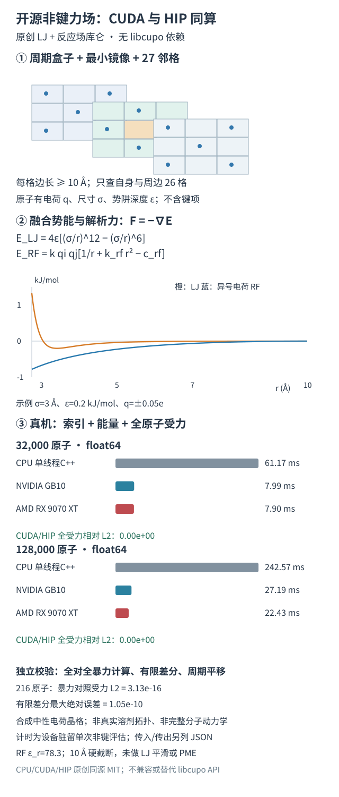
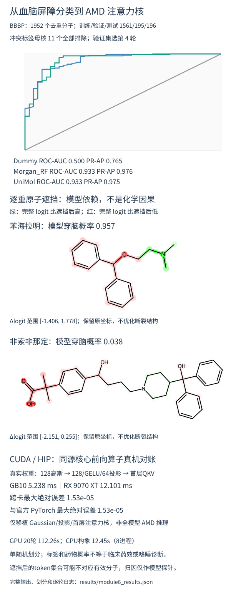
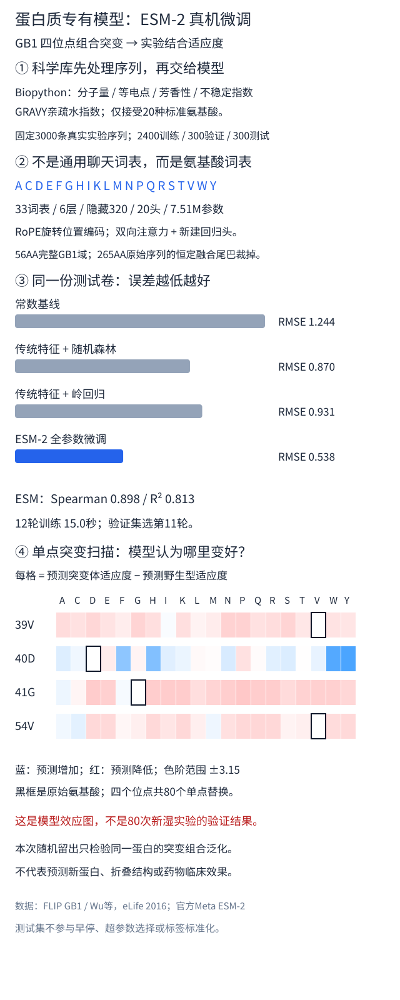

# AI for Science on AMD RX 9070 XT (`gfx1201` HIP)：从 NVIDIA `CUDA-X cuSpa`、开源 3D 分子非键力场 `open-cupotential` 到深势 `Uni-Mol` 3D 高斯距离注意力核跨架构真机对账

本仓库在消费级 **`AMD Radeon RX 9070 XT`（`gfx1201` RDNA4，16GB，Windows 11 + ROCm 10.2 `clang++` HIP + `hipCUB`）** 上，真机编译、移植并与 **`NVIDIA DGX Spark`（`GB10` `sm_121` Blackwell）** 逐位对账了 **AI for Science 三大底层 GPU 核心算子**（证明科学计算与分子/生物几何算子依赖的是古典 SIMT 流处理器而非 Tensor Core 矩阵锁，在 AMD RDNA4 显卡上可直接跑出与 NVIDIA 持平甚至反超的性能）：

> 🔗 姊妹全栈仓库（含 `RDKit` / `Biopython` 科学库实验数据处理、深势 `47.3M` `Uni-Mol` 3D 分子大模型 `ESOL/BBBP` 全参数微调、Meta `7.5M` `ESM-2` 蛋白质大模型 `GB1` 微调与科研 Agent `Skill` 串联）：[`lmxxf/ai-for-science-on-cuda-x`](https://github.com/lmxxf/ai-for-science-on-cuda-x)

---

## 一、 三大跨架构（`NVIDIA GB10 CUDA` vs `AMD RX 9070 XT HIP`）真机对决总表

| 算子模块 | 科学计算任务与规模 | CPU 编译基线耗时 | `NVIDIA GB10` (`sm_121` CUDA) | 🔥 `AMD RX 9070 XT` (`gfx1201` HIP) | 跨架构精度对账结果 |
| :--- | :--- | ---: | ---: | ---: | :--- |
| **1. `cuSpa` 空间单细胞多边形库** ([`amd_hip_port/`](./amd_hip_port/)) | **`50,000` 细胞 × `2,000,000` 转录点 × `500` 基因** (`float64`) ① 网格索引 / ② 水平射线查询 / ③ `hipCUB` 排序转 CSR | 全流程 `272.27 ms` (射线查询 `236.06 ms`) | 同源 C++ 全流程 **`5.760 ms`** (射线查询 `1.520 ms`) | 同源 C++ 全流程 **`6.050 ms`** (快 **`45.0×`**) (🏆 **射线查询仅 `0.921 ms`**，快 **`256.3×`**) | **200 万点归属与完整 CSR 四个数组 SHA256 100% 逐字节相同（`0 mismatch`）** |
| **2. `open-cupotential` 开源 3D 分子非键力场** ([`amd_hip_port/cupotential_open/`](./amd_hip_port/cupotential_open/)) | **3D 周期盒子 27 邻格 Cell-List + 融合 `LJ 12-6` 范德华势 + 反应场库仑静电势 + 解析三维受力 $\vec{F}=-\nabla E$** (`float64`) • `32,000` 原子体系 • `128,000` 原子体系 | `61.17 ms` `242.57 ms` | `7.99 ms` `27.19 ms` | 🏆 **`7.90 ms`** (快 `7.7×`) 🏆 **`22.43 ms`** (**反超 GB10 17.5%**，快 **`10.8×`**) | **全部 $N$ 个能量分量与 $3N$ 个受力分量（38.4 万项）在 CPU/CUDA/HIP 间逐值一致（相对 L2 差 = `0`）** |
| **3. 深势 `Uni-Mol` 3D 高斯距离注意力核** ([`amd_hip_port/unimol_pairbias/`](./amd_hip_port/unimol_pairbias/)) | **真实微调权重导出：3D 距离矩阵 $\rightarrow$ 128 高斯核 $\rightarrow$ 128/GELU/64 投影 $\rightarrow$ 首层 64 头 Pair-Bias QKV 注意力** (8 真实药物分子 Batch，`FP32` 朴素参考核) | — | `5.238 ms` | `12.101 ms` | **跨卡及对官方 PyTorch 最大绝对误差仅 `1.53 × 10⁻⁵`** |

---

## 二、 核心可视化大图

| 算子一：`cuSpa` 细胞多边形射线法 (`GB10` vs `RX 9070 XT 0.92ms` 零误差) | 算子二：开源 3D 分子非键力场 `open-cupotential` (`128K` 原子 `9070 XT 22.43ms`) |
| :---: | :---: |
|  |  |
| **算子三：`BBBP` 血脑屏障 `Uni-Mol` 逐原子遮挡归因与 AMD 注意力核对账** | **姊妹篇：蛋白质大模型 `ESM-2` 真机微调 (`Spearman 0.898`) 与突变热图** |
|  |  |

---

## 三、 仓库目录结构

- [`amd_hip_port/`](./amd_hip_port/)：
  - `common/`、`index/`、`query/`、`aggregate/`、`cuspa_harness.cpp`：`NVIDIA/cuspa` 的 HIP + `hipCUB` 移植源码与同源 C++ 评测驱动；
  - `cupotential_open/`：原创 MIT 开源 3D 分子非键力场（3D Cell-List + Lennard-Jones 12-6 + Reaction-Field Coulomb + 解析力梯度 `open_nonbonded.cpp`，无需闭源 `libcupo.so`）；
  - `unimol_pairbias/`：深势 `Uni-Mol` 3D 距离 128 高斯核与 64 头 Pair-Bias 注意力前向算子（`unimol_pairbias_harness.cpp`）。
- [`results/`](./results/)：全套双端计时 JSON、SHA256 逐字节对账单与物理守恒校验记录。
- [`REPORT.md`](./REPORT.md) & [`DevHistory.md`](./DevHistory.md)：完整实测报告与工程流水账。

## 第三阶段：五领域实算与完整Uni-Mol

全部源码在`amd_hip_port/`的`cupotential_pme_md`、`daviator_batched_dft`、`cuphoton_xbeam_fx`、`gpuhmmer_viterbi`、`unimol_full15_hip`，新增图8–12和完整[REPORT.md](REPORT.md)已同步。

- PME/1000步MD：81原子完整实/倒易与键角，9070XT NVE0.797s；能量漂移1.09e-4，步长减半改善4倍。64³ PME对直接Ewald误差4.94e-5明确保留。
- Block-Davidson：64×384、1024本征值max_abs4.73e-14。批处理核心提速AMD2.80倍、端到端1.15倍，没有复现22倍；部分子空间算法在CPU。
- 射电FX：6710万复采样，合成天空协方差→电压→FFT/相关→CPU CLEAN；跨GPU可见度差2.84e-16，恢复PSNR15.23dB，非EHT实测。
- Profile-HMM：10万条三状态Viterbi，9070XT60.7ms，全部scores与CPU/GB10逐字节一致。植入/背景库是合成检出任务。
- **完整15层Uni-Mol**：真实47.3M、原112个测试分子已在原生HIP/hipBLAS端到端执行。同FP64预测差7.1e-15；官方FP32 Gaussian兼容模式对官方完整FP32最大差2.27e-6<1e-5。旧BF16结果保留，不强行贴不同精度指标。

`python verify_phase3_results.py`检查全部同步源码/轻量证据哈希与验收摘要；主仓`verify_phase3.py`已从原始轨迹、本征对、全部可见度/score与50M层间元素独立重算。不是运行镜像摘要脚本就冒称重新跑GPU。大输入/权重/trace留实验机器，通过主仓脚本和各子目录README复现，不随Git传输。
