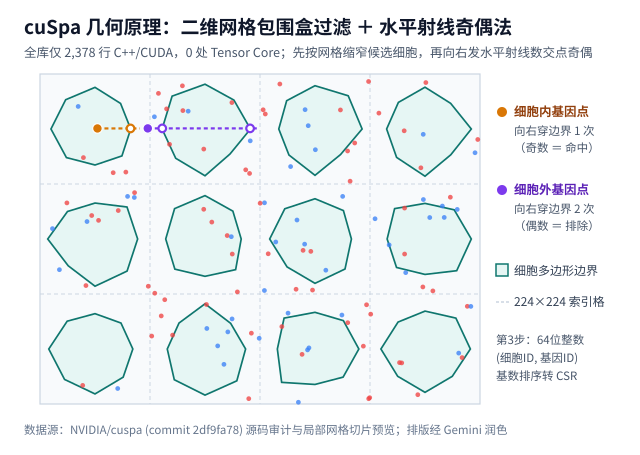
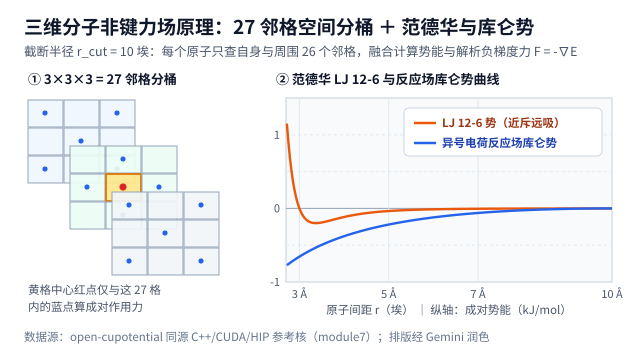
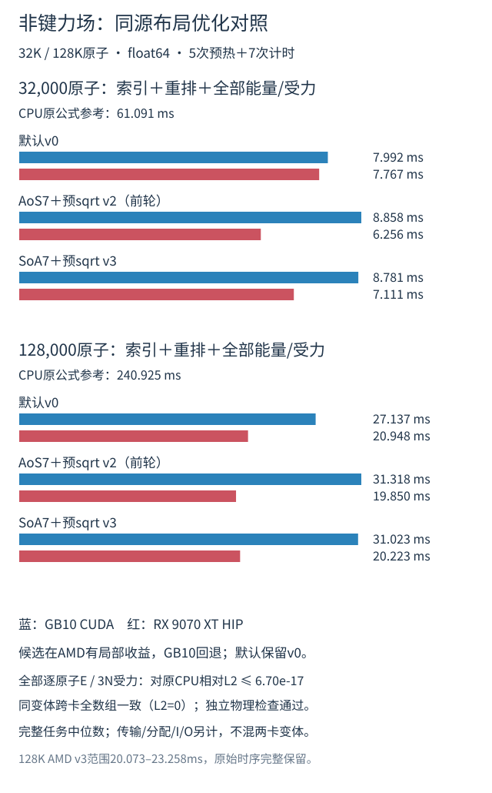
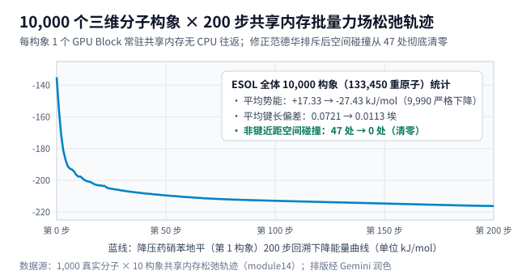
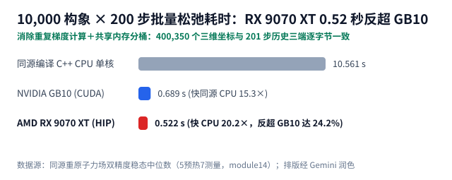
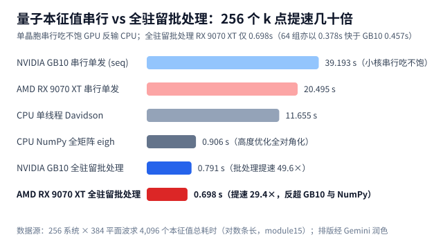
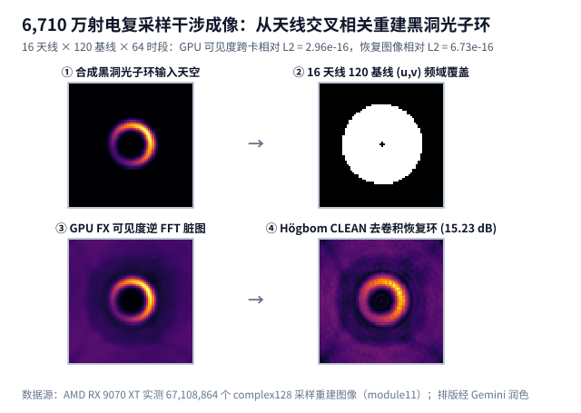
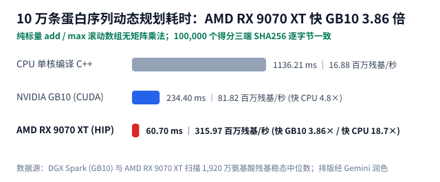

# AI for Science on AMD RX 9070 XT：七大科学算子实测

把科学计算里的几何、力场、FFT、特征值和动态规划搬上消费级 AMD 显卡：**同一份输入，同源 CUDA/HIP 内核，CPU 参考答案，全量数值对账。** 另附深势 **47.3M、全15层 Uni-Mol** 的原生 HIP / hipBLAS 端到端推理。

## 六门学科，传统软件与 CUDA-X 怎么分工？

| 科学领域 | 常用传统软件 | NVIDIA CUDA-X 对应库 | GPU 接手哪一步？ |
|---|---|---|---|
| 空间单细胞生物学 | Scanpy、Shapely | **cuSpa** | 细胞多边形索引、点归属、细胞×基因统计 |
| 分子动力学 | OpenMM、GROMACS | **cuPotential** | 邻居列表、非键受力、PME长程静电、时间积分 |
| 小分子化学 | RDKit | **nvMolKit** | 大批量三维构象力场松弛 |
| 材料量子计算 | VASP | **Daviator** | 多组小体系的批处理本征值求解 |
| 射电天文 | 传统射电关联与成像软件 | **cuPhoton.xBeam** | 分信道FFT与全基线复数交叉相关 |
| 蛋白质序列注释 | Biopython、HMMER | **GPU-HMMER** | Profile-HMM三状态动态规划扫描 |

测试设备：**AMD RX 9070 XT，gfx1201，16GB，Windows 11＋ROCm 10.2**；对照为 **NVIDIA DGX Spark GB10，sm_121**。科学核使用FP64或complex128，两端关闭FMA融合收缩与fastmath。

[全栈姊妹仓库](https://github.com/lmxxf/ai-for-science-on-cuda-x)负责RDKit/Biopython数据处理、Uni-Mol与ESM-2微调和科研Skill编排；本仓聚焦原生HIP科学算子与跨架构核验。

## 七大算子实测总表

CPU列为 **DGX Spark GB10主机ARM单线程基线**；PME与FX使用Python/NumPy/SciPy。时间按各项实际任务计量，传输与磁盘I/O另记；Davidson列明确包含初始化、上传和最终下载。

| 模块 | 完整任务 | CPU基线 | GB10 CUDA | RX 9070 XT HIP | 精度与结果 |
|---|---|---:|---:|---:|---|
| **1 cuSpa** | 5万细胞×200万点×500基因：索引＋查询＋CSR | **272.274ms** | **5.760ms** | **6.050ms** | 点归属＋CSR共4个输出数组逐字节一致 |
| ↳ 射线查询阶段 | 同一200万点查询 | 236.064ms | 1.520ms | **0.921ms** | AMD在这个阶段领先；全流程GB10更快 |
| **2 非键力场（默认v0）** | 32,000 / 128,000原子，LJ＋反应场库仑＋解析力 | 61.091 / 240.925ms | 7.992 / 27.137ms | **7.767 / 20.948ms** | 默认核全E/F三端L2＝0；预sqrt候选对原CPU≤6.70e-17 |
| **3 PME动力学** | 81原子、64³网格、1,000步NVE / NVT | 2.873 / 2.872s | 1.063 / 1.067s | **0.797 / 0.658s** | 初始跨卡受力L2＝4.66e-16；步长减半漂移改善4倍 |
| **4 批量构象松弛** | 1,000真实ESOL分子×10新构象×200步 | 10.560909s | 0.689281s | **0.522216s** | 400,350个有效坐标及201步能量历史三端逐字节一致 |
| **5 全驻留Davidson** | 64 / 256组，每组384维、求16根；含设置与传输 | 3.212 / 11.655s | 0.457 / 0.791s | **0.378 / 0.698s** | 4,096根本征值对精确解max_abs≤7.22e-15 |
| **6 射电FX** | 16天线×120基线，67,108,864个复采样，完整F＋X | 1.056032s | 0.039637526s | **0.0198092s** | 跨卡可见度L2＝2.96e-16；共同CPU CLEAN图像L2＝6.73e-16 |
| **7 Profile-HMM** | 100,000条序列、19,179,665残基、56位点M/I/D | 1,136.210ms | 234.400ms | **60.701ms** | 全部10万得分三端逐字节一致 |

最新构象与FX记录来自 [`current_steady_state`及稳态账本](results/optimization_20261125/latest_ledger.json)：GPU完整预热5遍、正式7遍；CPU预热1遍、正式3遍。AMD FX的7次范围为19.731–21.024ms，表中取中位数。其他项目的原始计时、误差与校验见各节JSON。

## 1. cuSpa：数清每个细胞里的基因点

**实现：原源码HIP迁移。** NVIDIA cuSpa的Apache-2.0源码共11个C++/CUDA文件、2,378行；几何与索引算法保留，CUDA Runtime/CUB映射到HIP/hipCUB。

输入是细胞膜二维多边形、转录点坐标和基因编号；输出是每个点所属细胞，以及细胞×基因CSR矩阵。先用224×224均匀网格的包围盒过滤候选，再发水平射线数边界交点，最后把`(cell_id,gene_id)`打包、基数排序、游程计数。

这套合成空间组学量级负载上，**全流程AMD 6.050ms、GB10 5.760ms；仅射线阶段AMD 0.921ms、GB10 1.520ms**。200万点归属与完整CSR逐字节一致。

源码实际位于[`common/`](amd_hip_port/common/)、[`index/`](amd_hip_port/index/)、[`query/`](amd_hip_port/query/)、[`aggregate/`](amd_hip_port/aggregate/)，入口是[`cuspa_harness.cpp`](amd_hip_port/cuspa_harness.cpp)与[`hipify_headers.py`](amd_hip_port/hipify_headers.py)。[完整对账JSON](results/module5_amd9070_results.json)；[数据导出与CPU基准驱动](https://github.com/lmxxf/ai-for-science-on-cuda-x/blob/main/exp3_cudax_cuspa_benchmark.py)。

## 2. 非键力场：计算原子之间的推拉力

**实现：原创同源核。** cuPotential的OpenMM插件开源，核心`libcupo.so`及相关运行时为专有许可；本节按公开公式实现独立的CPU/CUDA/HIP非键核。

输入是周期盒中的坐标、电荷、LJ参数；输出是每个原子的能量和三维受力。三维Cell-List把原子分桶，每个原子只查自身与周围27格；融合计算Lorentz–Berthelot混合的LJ12–6、反应场库仑势和解析梯度。

本轮比较了原核v0、连续AoS7重排v1/v2与SoA7重排v3。预sqrt候选在AMD有局部收益，但GB10回退；**默认保留v0**，两卡始终比较相同变体。5次预热、7次测量，完整计时包括Cell-List、重排与求力。

| 原子数 | 同源变体 | GB10 / ms | RX 9070 XT / ms |
|---:|---|---:|---:|
| 32,000 | 默认v0 | 7.992 | 7.767 |
| 32,000 | AoS7＋预sqrt v2（前轮） | 8.858 | 6.256 |
| 32,000 | SoA7＋预sqrt v3 | 8.781 | 7.111 |
| 128,000 | 默认v0 | 27.137 | 20.948 |
| 128,000 | AoS7＋预sqrt v2（前轮） | 31.318 | 19.850 |
| 128,000 | SoA7＋预sqrt v3 | 31.023 | 20.223 |

全部逐原子能量及3N受力对原公式CPU相对L2≤6.70e-17，跨卡全数组一致；独立全配对、有限差分、周期平移和净力检查通过。[完整对照](results/module7_optimized_results.json) · [参数与复测记录](MODULE7_OPTIMIZATION_NOTES.md)

[源码与物理参数](amd_hip_port/cupotential_open/) · [执行驱动](exp5_open_cupotential_hip.py) · [实测JSON](results/module7_results.json)

## 3. PME＋动力学：把远处的电荷也算进去

**实现：原创同源物理原型。** cuPotential的倒易空间核心由专有运行时提供；这里自行实现四阶B样条铺电、64³网格FFT、Ewald格林函数反卷积与一致的能量梯度。

输入81个原子的坐标、电荷、质量与键角拓扑；输出每步势能、动能、温度、键长记录和最终坐标。CUDA调用cuFFT，HIP调用hipFFT；LJ、实空间erfc库仑、倒易项、自能和谐振键角共同参与每一步受力。

27个合成柔性三原子分子，**完整1,000步GPU循环设备驻留**。NVE最大相对能量漂移1.09e-4；相同步长减半、步数加倍，漂移改善4.0004倍。BAOAB热浴后半段297.35±27.57K。64³网格对独立直接Ewald的受力L2误差4.94e-5，细化到128³降至5.84e-6。

[源码与积分器](amd_hip_port/cupotential_pme_md/) · [驱动](exp7_pme_and_fused_md_hip.py) · [轨迹与精度JSON](results/module9_results.json)

## 4. 一万个构象：批量松弛三维姿势

**实现：原创同源批量松弛核。** [NVIDIA-BioNeMo/nvMolKit](https://github.com/NVIDIA-BioNeMo/nvMolKit)按Apache-2.0开源；本仓以明确参数的简化重原子力场，实测block-per-conformer的批量并行机制。

输入为ESOL前1,000分子各10个**新ETKDG起点**，加0.06Å显式扰动；输出优化坐标与201个能量记录。模型包含键长、余弦键角、二/三周期扭转及图距≥3的LJ＋库仑项。

优化版每构象32线程，每个力场项只计算一次，再按原子固定顺序汇集梯度；回溯试探只算能量。**8,320个构象走共享内存参数缓存，1,680个较大构象走全局暂存回退，全部样本保留。** 最终耗时CPU 10.560909s、GB10 0.689281s、AMD 0.522216s，坐标和完整历史逐字节一致。

平均键偏差0.0721→0.0113Å，声明的近碰撞47→0。初版弱排斥曾出现47→1138，失败和修正均保留；新起点哈希不变。旧RDKit的66.608s包含ETKDG＋真正MMFF94，与本节简化模型分开记录。

[源码](amd_hip_port/nvmolkit_batched_conformer/) · [优化基准入口](benchmark_conformer_optimized.py) · [最新及历史JSON](results/module14_results.json)

## 5. 全驻留Block-Davidson：一次求256组小矩阵

**实现：原创同源本征值求解原型。** Daviator是面向VASP/ALCHEMI的官方产品；本仓按公开的Block-Davidson方法自行实现求解核。

输入64或256组384×384周期势哈密顿量，每组求最小16个本征值与向量。`H·V`、Rayleigh–Ritz投影、共享内存Jacobi、两遍MGS正交化和厚重启，全部放入每组一个持久Block；迭代中主机往返为0。

256组共4,096根，**AMD完整批处理0.698s、GB10 0.791s**，含设置、上传和最终下载；同原型AMD逐组串行20.495s。对独立`eigvalsh`的最大本征值误差7.22e-15，残差与正交性也逐项核对。表中CPU是迭代基线11.655s，直接NumPy `eigvalsh`另测0.906s。

[持久核源码](amd_hip_port/daviator_batched_dft/resident.cpp) · [驱动](exp13_daviator_resident_hip.py) · [全驻留结果](results/module15_results.json)

## 6. 射电FX：从电压流算出干涉可见度

**实现：原创同源干涉原型。** [官方cuPhoton（含xBeam）](https://github.com/NVIDIA/cuPhoton)已按Apache-2.0开源；本仓是独立FP64 FFT与复数相关实现。

输入16天线、4,096帧、每帧1,024个复数电压采样；F阶段做FFT分信道，X阶段对120条基线按时间积累`Sa·conj(Sb)`，输出7,864,320个复数可见度。共同CPU后处理再做uv网格化、逆FFT与Högbom CLEAN，恢复合成非对称光子环。

两卡统一选用**v2：预计算旋转因子、512线程FFT、2通道共享面板X**。预热5遍、测7遍，完整F＋X为**GB10 39.637526ms、AMD 19.8092ms**；CPU为1.056032s。全量可见度对CPU误差<4.5e-16，跨卡CLEAN图像L2＝6.73e-16。原型的合成天空、电压和恢复图共用同一物理模型。

提速主要来自FFT；X寄存器复用曾在GB10变慢，三种变体和原始计时都保留。该计时是驻留F＋X，传输与CPU成像另列。

[同源FFT/FX源码](amd_hip_port/cuphoton_xbeam_fx/fx.cpp) · [驱动](exp9_cuphoton_blackhole_fx_hip.py) · [最新稳态与历史](results/module11_results.json) · [优化证据](results/module11_optimized_results.json)

## 7. Profile-HMM：十万条蛋白质的模糊匹配

**实现：原创同源M/I/D动态规划核。** 传统HMMER及官方推文中的GPU加速版为开源软件；本仓独立实现三状态Viterbi搜索核心。

输入真实GB1数据构造的56位点发射轮廓和100,000条序列，输出每条序列的最高log2匹配分数。匹配M、插入I、删除D允许序列里出现错字、多字和缺字；每个线程独立处理一条序列。

19,179,665个残基，**AMD 60.701ms、315.97M残基/s；GB10 234.400ms**。10万分数三端逐字节相同，SHA256以`aaf96d10`开头。500条植入GB1域与99,500条随机背景构成此次检出负载，ROC-AUC＝1.0。

[源码](amd_hip_port/gpuhmmer_viterbi/viterbi.cpp) · [驱动](exp10_gpuhmmer_viterbi_hip.py) · [评分与计时JSON](results/module12_results.json)

## 完整15层Uni-Mol：原生HIP＋hipBLAS端到端推理

深势Uni-Mol是开源PyTorch分子模型。本仓把微调后的**195个权重张量、47,331,139个参数**导出，完整实现128高斯核、64头成对偏置逐层演化、15层Transformer和实际`512→1`回归头，直接用HIP C++与hipBLAS推理。

输入112个真实ESOL测试分子的原子、距离矩阵；输出112个水溶性logS：

| 完整推理验证 | 结果 |
|---|---:|
| 同公式FP64：AMD对GB10最大预测差 | **7.11e-15 logS** |
| AMD FP64测试RMSE / R² | **0.573634 / 0.930467** |
| 全部逐层检查元素 | **50,501,632** |
| 最大逐层node误差 | **9.09e-13** |
| 对齐官方Gaussian内部FP32后的最大预测差 | **2.27e-6 logS** |
| 112分子FP64设备计算：GB10 / AMD | **1.756 / 2.291s** |

[完整引擎源码](amd_hip_port/unimol_full15_hip/) · [导出与对账驱动](exp11_unimol_full15layer_amd9070.py) · [FP64完整结果](results/module13_results.json) · [官方FP32兼容对账](results/module13_mixed_precision_results.json)

## 从哪里运行与核对？

- Windows各算子目录提供`build_windows.cmd`和`run_windows.cmd`；优化FX使用[`build_optimized_windows.cmd`](amd_hip_port/cuphoton_xbeam_fx/build_optimized_windows.cmd)与[`run_optimized_windows.cmd`](amd_hip_port/cuphoton_xbeam_fx/run_optimized_windows.cmd)，构象使用对应[`optimized_build_windows.cmd`](amd_hip_port/nvmolkit_batched_conformer/optimized_build_windows.cmd)。工具链为现有Visual Studio＋ROCm，工作目录独立于其他项目。
- 主仓负责大输入、RDKit/模型权重导出与完整独立复算：[主流水线](https://github.com/lmxxf/ai-for-science-on-cuda-x/blob/main/run_pipeline.py)、[cuSpa输入导出](export_module5_reference.py)、[完整物理数值验收](https://github.com/lmxxf/ai-for-science-on-cuda-x/blob/main/verify_phase3.py)、[构象与驻留求解验收](https://github.com/lmxxf/ai-for-science-on-cuda-x/blob/main/verify_phase4.py)。
- 本仓轻量证据核验入口：[第三阶段](verify_phase3_results.py)、[第四阶段](verify_phase4_results.py)。源码、参数、JSON/SHA256与16张图在仓内；大输入、权重与完整原始trace通过上述驱动准备。
- 更多工程记录：[REPORT.md](REPORT.md)、[DevHistory.md](DevHistory.md)、[最新优化账本](results/optimization_20261125/latest_ledger.json)。cuSpa保留上游Apache-2.0许可；原创原型各目录附MIT许可。
