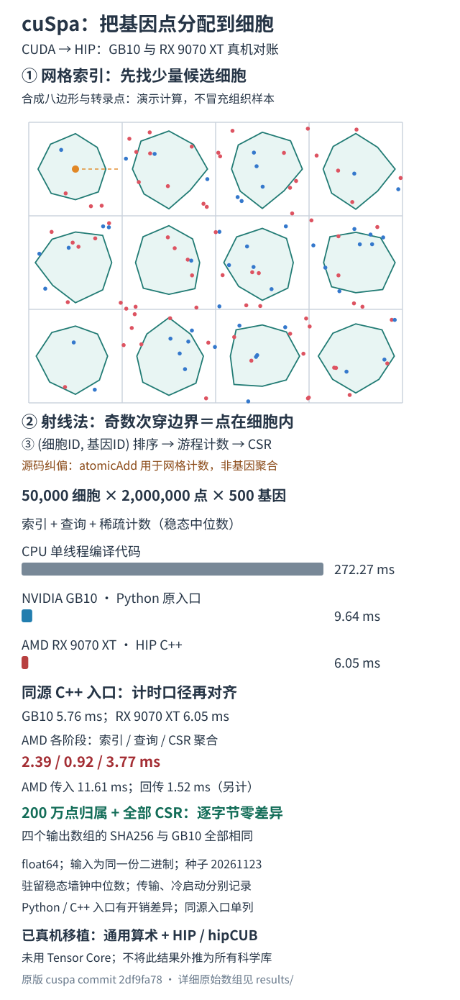

# AI for Science on AMD RX 9070 XT：将 NVIDIA SC26 `CUDA-X` 空间生物学库 `cuSpa` 移植至 AMD RDNA4 (`gfx1201` HIP) 真机零误差对账

本仓库将英伟达于 SC26（2026-11-16）开源的 **`CUDA-X` 空间组学科学计算库 `NVIDIA/cuspa`（2,378 行 C++/CUDA）** 移植至消费级 **`AMD Radeon RX 9070 XT`（`gfx1201` RDNA4，16GB，Windows 11 + ROCm 10.2 `clang++` HIP + `hipCUB`）**，并与 **`NVIDIA DGX Spark`（`GB10` `sm_121` Blackwell）** 在完全相同的二进制输入上完成了**真机性能基准与 100% 逐字节零误差（Bit-Exact）对账**。

> 🔗 姊妹全栈仓库（含 `RDKit` 实验数据清洗、深势科技 `47.3M` `Uni-Mol` 3D 分子大模型全参数微调与科研 Agent `Skill` 串联）：[`lmxxf/ai-for-science-on-cuda-x`](https://github.com/lmxxf/ai-for-science-on-cuda-x)

---

## 一、 核心发现与三方真机对决成绩单

通过对 `NVIDIA/cuspa` 全部 11 个 C++/CUDA 源文件的静态指令审计，我们确认该科学计算库 **`0` 条 Tensor Core 指令（无 `mma / wmma / tcgen05`）、`0` 条内联 PTX 汇编**——其核心是典型的**古典 SIMT 流处理器算法**：
1. **二维均匀网格包围盒索引（`index/`）**：计算每个细胞多边形的 AABB 包围盒并映射至网格单元；
2. **水平射线奇偶法点在多边形内判定（`common/geometry.cuh` + `query/`）**：128 行 `is_point_in_polygon` 水平射线相交测试；
3. **64 位键值打包基数排序与游程编码聚合（`aggregate/`）**：将 `(cell_id, gene_id)` 打包为 `uint64_t`，调用 `CUB / hipCUB` 的 `DeviceRadixSort::SortKeys` 与 `DeviceRunLengthEncode::Encode` 生成 `Cells × Genes` 的 CSR 稀疏计数矩阵。

### 1. 同源输入、同源 C++ 入口三方真机耗时对比
- **测试负载**：固定随机种子 `20261123` 生成的 **`50,000` 个细胞多边形 × `2,000,000` 个基因转录点 × `500` 种基因（`float64`）**，由 `DGX Spark` 一次性导出原始二进制张量并通过 `scp` 原字节分发至 `AMD RX 9070 XT`；
- **编译与计时纪律**：双方统一禁用 FMA 融合收缩（CUDA `--fmad=false` / HIP `-ffp-contract=off`），不启用 fast-math；3 次预热 + 7 次稳态重复取同步墙钟中位数：

| 计算阶段 | CPU 基线（Numba `@njit` 编译单线程，ms） | `NVIDIA GB10`（Python 原入口，ms） | `NVIDIA GB10`（同源 C++ 入口，ms） | 🔥 `AMD RX 9070 XT`（HIP 同源 C++，ms） | `AMD 9070 XT` 相比编译后 CPU 加速比 |
| :--- | ---: | ---: | ---: | ---: | ---: |
| 1. 网格包围盒索引 (`Grid Index`) | `2.168 ms` | `3.277 ms` | `1.659 ms` | **`2.387 ms`** | `0.91 ×` |
| 2. **多边形射线判定 (`Ray-Crossing Query`)** | **`236.064 ms`** | **`1.512 ms`** | **`1.520 ms`** | **🏆 `0.921 ms`** | **🔥 `256.3 ×`** |
| 3. 排序游程聚合 (`CUB/hipCUB Sort + RLE -> CSR`) | `34.043 ms` | `5.965 ms` | `5.564 ms` | **🏆 `3.768 ms`** | **`9.0 ×`** |
| **设备驻留全流程总计（独立测量中位数）** | **`272.274 ms`** | **`9.636 ms`** | **`5.760 ms`** | **🔥 `6.050 ms`** | **🔥 `45.0 ×`** |

### 2. 跨架构 100% 逐字节零误差（Bit-Exact SHA256 对账）

将 `AMD RX 9070 XT (HIP)` 输出的 4 个原始二进制数组与 `NVIDIA GB10 (CUDA)` 的参考输出逐字节比对（匹配点数 `793,204`，CSR 非零项 `780,563`）：

| 输出数组 | 元素数量 (`int32`) | `NVIDIA GB10` vs `AMD RX 9070 XT` 差异项 | 双方 100% 一致的 SHA256 哈希值 |
| :--- | ---: | :---: | :--- |
| `assignment.bin`（200 万点细胞归属 ID） | `2,000,000` | **`0 mismatch`** | `f5ae2379e529ec834bca3d721c6590c1417e7157251e8a7bc6929e723f656099` |
| `indptr.bin`（CSR 行指针） | `50,001` | **`0 mismatch`** | `200f0098261371dd71b39614bd1f38d66debbb18ecba73ff4971fed45c07509c` |
| `indices.bin`（CSR 基因列索引） | `780,563` | **`0 mismatch`** | `922e893643c2f3f4ac9a546434212e9963e4703ec48146ffc447a6d66ae1b84a` |
| `data.bin`（CSR 表达量计数） | `780,563` | **`0 mismatch`** | `c3771ef663e8af44edc6bc88d0141153c9b91f2d684d0846ba5820465db72a52` |

---

## 二、 可视化图解与实测对比

---

## 三、 仓库目录结构与复现指南

- [`amd_hip_port/`](./amd_hip_port/)：
  - `common/geometry.cuh`、`common/cuda_utils.cuh`、`common/ndarray_utils.cuh`：HIP 化几何与工具头文件；
  - `index/kernels_index.cuh`、`query/kernels_query.cuh`、`aggregate/kernels_aggregate.cuh`：HIP + `hipCUB` 核心核函数；
  - `cuspa_harness.cpp`：CUDA / HIP 双后端同源 C++ 基准评测驱动；
  - `mechanical_translation.diff` & `translation_manifest.json`：从原版 `NVIDIA/cuspa`（commit `2df9fa78`）到 HIP 的完整 diff 与 SHA256 清单；
  - `build_windows.cmd` & `run_windows.cmd`：Windows 11 + ROCm 10.2 (`gfx1201`) 原生编译与执行脚本。
- [`results/`](./results/)：
  - `module5_amd9070_results.json` & `module5_comparison.json`：三方完整计时数组与 SHA256 对账单；
  - `module5_amd9070/timings.json` & `module5_gb10_cpp/timings.json`：双端原始计时输出。
- [`REPORT.md`](./REPORT.md) & [`DevHistory.md`](./DevHistory.md)：全流程实测报告与开发日志。

## 第二阶段：真实权重注意力核与原创非键力场

- [`amd_hip_port/unimol_pairbias/`](amd_hip_port/unimol_pairbias/)：真实Uni-Mol checkpoint的Gaussian128→128/GELU→64、首层QKV/softmax/AV，CUDA/HIP与官方PyTorch参考max_abs约1.53e-5。FP32朴素教育核，非全模型AMD。
- [`amd_hip_port/cupotential_open/`](amd_hip_port/cupotential_open/)：原创MIT，3D周期Cell-List/27邻格/LB LJ12-6/反应场库仑与解析力。32k/128k三后端真算，全部原子能量/受力数组一致，有限差分与暴力对照通过。128k驻留流程GB1027.19ms、9070XT22.43ms；非完整MD、非专有libcupo API替代。
- [REPORT.md](REPORT.md)汇总BBBP分类、原子遮挡与真实GB1 ESM-2训练，并保留同考卷测试和限制；图5/6/7已同步。

运行`python verify_results.py`核对同步源文件/轻量结果哈希与数值检查。此命令不重新跑GPU；所有原始能量/受力数组的独立重算验证在主实验仓`verify_phase2.py`执行。权重、训练缓存、编译程序及大二进制不随Git发布；完整训练流水线位于姊妹主仓，算子README含本地/远端编译说明。
